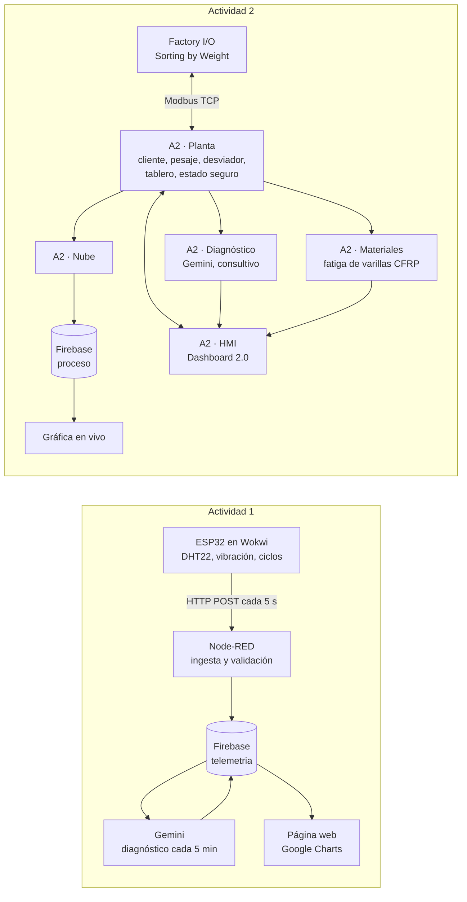

# SCADA 4.0 con Node-RED: telemetría IoT, clasificación por peso y capa de materiales

Proyecto de las **Actividades 1 y 2** de *Internet de las Cosas*. Une sensores
simulados, un cliente industrial Modbus contra una planta de Factory I/O, una
base en la nube, una HMI, diagnóstico con IA y un modelo de fatiga de material,
todo orquestado en **Node-RED** y verificado con pruebas automáticas.

| | |
|---|---|
| **Documento técnico final (PDF)** | [docs/entrega/Actividad2_documentacion_tecnica.pdf](docs/entrega/Actividad2_documentacion_tecnica.pdf) |
| **Respuesta a la revisión** | [docs/entrega/Actividad2_respuesta_a_la_revision.pdf](docs/entrega/Actividad2_respuesta_a_la_revision.pdf) |
| **Índice de toda la documentación** | [docs/README.md](docs/README.md) |
| **Descargar el código** | botón verde **Code → Download ZIP**, o `git clone` |

---

## Qué hace

**Actividad 1 — telemetría y diagnóstico.** Un ESP32 simulado en Wokwi
manda temperatura, vibración y ciclos a Node-RED, que valida cada lectura y la
escribe en Firebase Realtime Database. Cada 5 minutos Node-RED resume la
telemetría, pide un diagnóstico a Gemini y lo guarda. Una página con Google
Charts muestra todo en vivo, sin recargar.

**Actividad 2 — orquestación de una planta.** Node-RED actúa como cliente
Modbus TCP de la escena *Sorting by Weight* de Factory I/O: lee sensores y
báscula, pesa cada caja con la banda detenida, la clasifica en tres salidas con
un desviador de ruedas, atiende el tablero (Start, Stop y paro de emergencia) y
lleva la línea a un estado seguro si se pierde la comunicación. Cada caja y un
latido periódico se registran en Firebase; una HMI (Dashboard 2.0) permite
operar la línea desde la red local o la tailnet; Gemini da un diagnóstico
consultivo que nunca mueve la planta, y una **capa de materiales** calcula el
daño por fatiga de dos varillas virtuales de fibra de carbono a partir de cada
pesada.



## Estructura del repositorio

| Carpeta | Contenido |
|---|---|
| [`node-red/`](node-red) | `flows.json` (todas las pestañas), `funciones/` con el código de cada nodo de función (fuente de verdad; `construye_flows.py` arma `flows.json`), `settings.js` con la seguridad del editor y del túnel, `hmi/` con la plantilla de la HMI |
| [`config/`](config) | Mapas de registros Modbus y configuración de cada planta: sustituto simulado (`*_desviador.json`, `*_a2.json`) y Factory I/O (`*_fio.json`); parámetros de la capa de materiales (`materiales.json`) |
| [`firebase/`](firebase) | Reglas de la base (`database.rules.json`) y su preparación |
| [`firmware/wokwi/`](firmware/wokwi) | Sketch y diagrama del ESP32 de la Actividad 1 |
| [`web/`](web) | Página de telemetría (Actividad 1) y gráfica del proceso (Actividad 2) |
| [`tools/`](tools) | Herramientas en Python 3.9 sin dependencias: sonda Modbus, cálculo de límites del cliente, modelo de materiales, análisis de corridas e instrumentación |
| [`pruebas/`](pruebas) | Batería de pruebas automáticas, sustituto de la planta, emulador de Firebase, pruebas contra la escena real |
| [`datos/corridas/`](datos/corridas) | Datos crudos de cada corrida contra la escena (eventos, sondeo, nube, oráculo), para volver a calcular cualquier cifra |
| [`docs/`](docs) | Documento técnico, bitácoras, órdenes de cada fase, mediciones y reportes ([índice](docs/README.md)) |
| raíz | Scripts de operación: `prepara_a2.sh`, `demo_a2.sh`, `arranca.sh`, `apaga.sh`, `estado.sh`, `prepara_admin.sh` |

## Cómo correrlo

**Requisitos:** macOS o Linux, Node.js 22 y Node-RED 5, Python 3.9 o mayor.
Para la escena real, Factory I/O 2.5 (Windows) con el driver *Modbus TCP/IP
Server*; sin ella, todo corre contra el **sustituto** incluido, que emula la
planta por Modbus.

```bash
git clone <url-de-este-repositorio> IoT && cd IoT
cp .env.example .env            # llenar con tus propios valores (nunca se versiona)
./prepara_a2.sh                 # instala las paletas de Node-RED con versiones fijas
./prepara_admin.sh              # usuario y contraseña del editor (opcional)
./demo_a2.sh                    # revisa, arranca Node-RED y la página, imprime las URL
```

La planta que se usa la decide `.env`, nunca el código: sin `A2_MODBUS_HOST`
corre el sustituto local; con la IP de la máquina de Factory I/O,
`A2_SUSTITUTO=0` y la configuración `*_fio.json`, la escena real. La guía de la
demostración paso a paso está en [docs/DEMO_A2.md](docs/DEMO_A2.md) y la de la
Actividad 1 en [docs/ACTIVIDAD_1.md](docs/ACTIVIDAD_1.md) y
[docs/PASO_A_PASO.md](docs/PASO_A_PASO.md).

## Pruebas

```bash
./pruebas/bateria.sh                  # ~20 pruebas sin escena ni nube (~25 min)
./pruebas/bateria.sh --con-emulador   # además las reglas de Firebase en su emulador
```

La batería cubre el mapa de registros, el modelo de materiales (JavaScript
contra Python), el sustituto, la seguridad del editor y del túnel, el cliente
de la planta, la nube, la HMI, el diagnóstico, la instrumentación, el tablero,
los límites de recorrido y la prueba de extremo a extremo de la Actividad 1
(`prueba.sh`, 26 de 26). Las pruebas contra la escena real
(`pruebas/prueba_fio.py`) usan un oráculo independiente que lee Factory I/O
por su cuenta y compara caja por caja.

## Resultados principales

Todas las cifras salen de datos guardados en `datos/corridas/` y se pueden
recalcular con las herramientas de `tools/`.

| Medición | Resultado | Detalle |
|---|---|---|
| Clasificación contra Factory I/O | 600 de 600 cajas por la salida de su peso, en cada una de dos corridas de unos 47 min; sin desvíos, pérdidas ni cajas fantasma | [docs/corrida_L.md](docs/corrida_L.md) |
| Periodo de sondeo Modbus | mediana 52 ms, p95 54 ms | [docs/corrida_a2_fase4.md](docs/corrida_a2_fase4.md) |
| Latencia lectura → Firebase | mediana 53 ms, p95 57 ms; completitud 132 de 132 cajas | [docs/corrida_a2_fase4.md](docs/corrida_a2_fase4.md) |
| Capa de materiales | el modelo en Node-RED coincide con el de Python paso a paso; la HMI cambió de nivel en los pasos 264, 420 y 489 que predice el recálculo | [docs/corrida_materiales.md](docs/corrida_materiales.md) |
| Tablero y paro de emergencia | Stop y Emergency stop confirmados en la escena; latido de emergencia en Firebase 0.59 s después del paro | [docs/sesion_A.md](docs/sesion_A.md), [docs/sesion_S.md](docs/sesion_S.md) |
| Límites de recorrido | calculados con tiempos medidos en 2,086 cajas; ninguna los supera | [docs/corrida_H.md](docs/corrida_H.md) |
| Seguridad | editor con usuario y contraseña (bcrypt); por el túnel público solo entra la ingesta | `pruebas/prueba_seguridad.py` |

## Seguridad y credenciales

Este repositorio **no contiene credenciales**. Llaves de Firebase y Gemini,
cuentas de ingesta y de visor, contraseña del editor y llave de ingesta viven
solo en `.env` (ver [`.env.example`](.env.example)) y en archivos que se
generan a partir de él y no se versionan, como `web/config_a2.js`. Las reglas
de Firebase dejan escribir solo a la cuenta de ingesta y leer solo a la del
visor.

## Cómo está hecho

El proyecto se construyó por fases, cada una con una orden escrita, pruebas
que demuestran cada paso y un registro de lo hecho, lo medido y lo que no
coincidió con lo planeado: [docs/CICLO_DESARROLLO_A2.md](docs/CICLO_DESARROLLO_A2.md)
y, para la Actividad 1, [docs/BITACORA.md](docs/BITACORA.md).

---

Proyecto académico · 2026
